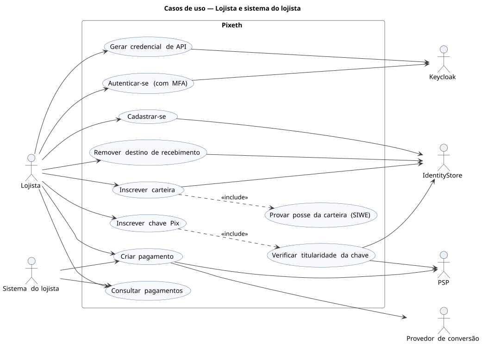
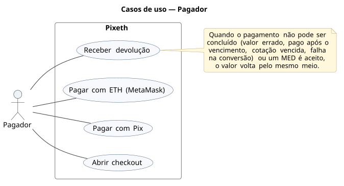

# 1. Casos de uso

Os diagramas mostram só quem usa o Pixeth para um objetivo próprio. Os sistemas que o Pixeth chama (Keycloak, IdentityStore, PSP e provedor de conversão) aparecem na [arquitetura](02-arquitetura.md) e nos [fluxos](fluxos/README.md).

## Lojista e sistema do lojista

O lojista usa a aplicação web, autenticado com MFA. O sistema do lojista usa uma credencial de API, gerada pelo lojista, que só permite criar e consultar pagamentos: quem a obtém não consegue mudar os destinos de recebimento. Um destino de recebimento é uma carteira ou uma chave Pix; ao inscrever uma chave Pix, o Pixeth confere no PSP se ela está no nome do lojista.

[Fonte](diagrams/src/casos-de-uso/uc-lojista.puml)

## Pagador

O pagador só usa o *checkout*, sem conta. Quando o pagamento não pode ser concluído, ou quando um MED é aceito, o valor volta pelo mesmo meio, sem que ele precise pedir. A contestação de um Pix por fraude (MED) é aberta fora do Pixeth, no banco do pagador.

[Fonte](diagrams/src/casos-de-uso/uc-pagador.puml)

## Processos automáticos

Depois de criado, o pagamento segue sem ação de ninguém: confirmação, conversão, liberação de retenções, tratamento de MED e repetição de tarefas não têm ator. São tarefas com `run_at`, executadas pelo executor de tarefas quando vencem (ver [Processamento assíncrono](fluxos/processamento-assincrono.md) e [Retenção e MED](fluxos/retencao-e-med.md)). A inscrição de um IdentityStore, ainda manual, está em [IdentityStore](fluxos/identitystore.md).
