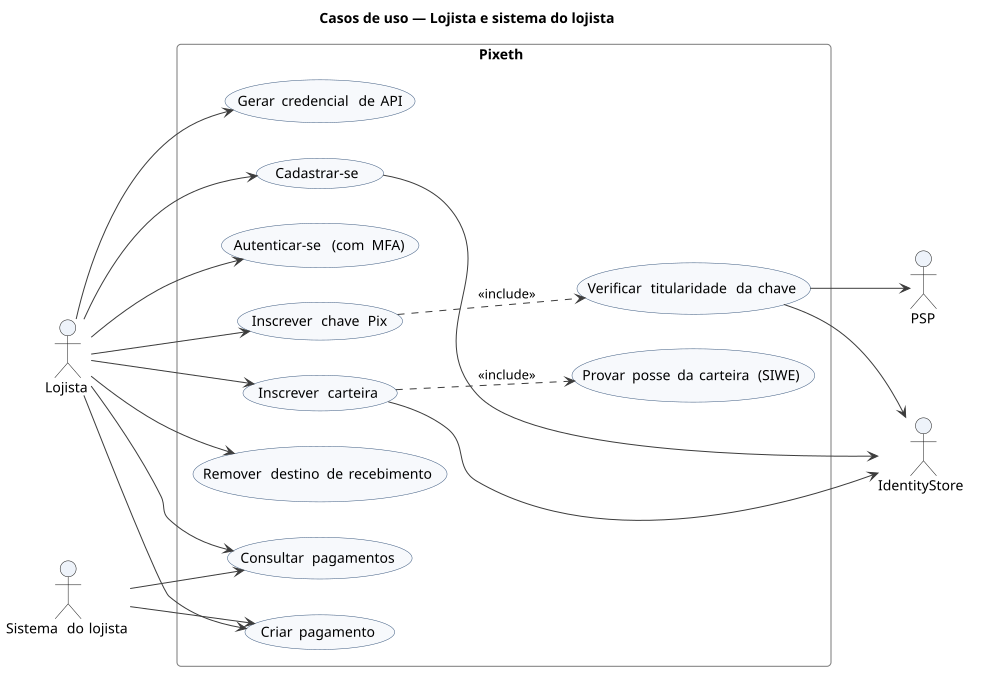
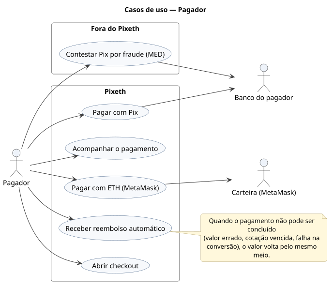
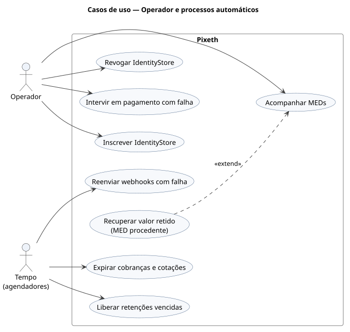

# 1. Casos de uso

## Lojista e sistema do lojista

[Fonte](diagrams/src/casos-de-uso/uc-lojista.puml)

## Pagador

O pagador só usa o *checkout*. A contestação de um Pix por fraude (MED) acontece fora do Pixeth, no banco do pagador.

[Fonte](diagrams/src/casos-de-uso/uc-pagador.puml)

## Operador e processos automáticos

[Fonte](diagrams/src/casos-de-uso/uc-operador.puml)
