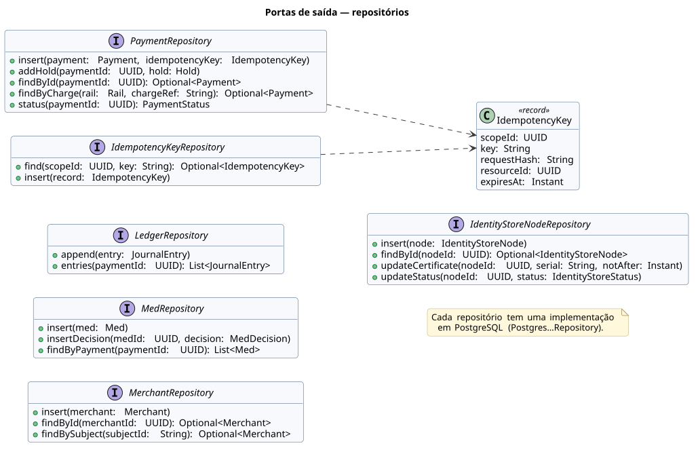

# 2. Arquitetura

## Decisões principais

- **Arquitetura hexagonal.** O núcleo só conhece portas, definidas nos termos dele. As portas de entrada (pagamentos, cadastro, IdentityStores, avisos de pagamento e execução de tarefas) recebem chamadas da API REST, dos *webhooks* do PSP, do ouvinte da *blockchain* e do executor de tarefas. As portas de saída (`PaymentRail`, `ConversionProvider`, `IdentityStore`, `JobQueue` e repositórios) são implementadas por adaptadores substituíveis. O que depende de tempo (liberar uma retenção, repetir uma tarefa) passa pelo executor, via `run_at`; não há agendadores à parte.
- **Sem operador no caminho do pagamento.** Depois de criado, o pagamento segue sozinho: confirmação, conversão, retenção, liberação, devoluções e tratamento de MED são tarefas automáticas. A única ação manual que resta é a inscrição de um IdentityStore (ver [IdentityStore](fluxos/identitystore.md)).
- **Crescimento linear.** Um novo sistema de pagamento entra com um novo adaptador de `PaymentRail`, sem adaptadores por par de sistemas. Cada trilho declara o que sabe fazer em `RailCapabilities`: se o que ele recebe pode ser revertido (`reversible`) e se ele consegue pagar ao lojista (`supportsPayout`). Um trilho que retém valores implementa também `HoldingRail`.
- **Criação síncrona, o resto assíncrono.** Criar o pagamento é uma chamada síncrona e idempotente: confere no IdentityStore se o destino é do lojista, cota o valor a pagar quando o valor do pagamento está em outro ativo e cria a cobrança no trilho de origem (o `PUT /cob/{txid}` do PSP pode ser repetido com segurança). O que acontece depois do pagamento roda em tarefas gravadas no PostgreSQL na mesma transação do fato que as gerou e executadas por qualquer réplica (`FOR UPDATE SKIP LOCKED`). Não há *broker* de mensagens.
- **Conversão terceirizada e agnóstica.** A conversão BRL ⇄ ETH fica atrás de `ConversionProvider`. O Pixeth recebe o pagamento e encaminha ao provedor o valor de cada pagamento (Pix ou `fundConversion()`), sem saldo pré-pago e sem depender de recursos de um PSP ou provedor específico. No TCC, a implementação é simulada: cota e converte com uma taxa configurável e usa uma carteira de teste na Sepolia, que deposita o ETH no contrato com `hold()`.
- **Retenção quando a origem é reversível.** Um pagamento é retido quando o trilho de origem é reversível e o de destino retém; hoje, Pix → Ethereum: o ETH fica no contrato por uma janela configurável antes de ser liberado ao lojista. Se chegar um MED, a retenção é congelada até a decisão do PSP; se ele for aceito, o valor é recuperado e devolvido ao pagador (ver [Retenção e MED](fluxos/retencao-e-med.md)).

## Portas e adaptadores

[Fonte](diagrams/src/arquitetura/componentes-hexagonal.puml)

As portas de saída estão em dois diagramas: de um lado trilhos, conversão, tarefas e identidade; do outro, os repositórios.

[Fonte](diagrams/src/arquitetura/portas-e-adaptadores.puml)

`JobQueue` tem um contrato que as assinaturas não mostram: `enqueue()` e `rearm()` só gravam na tabela `core.jobs`, na mesma transação do fato que gerou o passo, e os *workers* executam depois. `rearm()` insere a tarefa ou, se ela já existe, a reativa. Qualquer outra implementação precisa manter essa atomicidade com o fato.

[Fonte](diagrams/src/arquitetura/portas-repositorios.puml)

Cada tipo de tarefa é um passo do pagamento, igual para qualquer trilho; o trilho vem do pagamento (origem ou destino), e a tarefa chama o adaptador correspondente:

| Tarefa | Porta e operação | Trilho |
|---|---|---|
| `CONFIRM_PAYMENT` | `PaymentRail.confirmPayment` | origem |
| `FUND_CONVERSION` | `ConversionProvider.createOrder` + `PaymentRail.fundConversion` (envia ao provedor o valor recebido) | origem |
| `CONVERT` | `ConversionProvider.getOrder` (entrega do ativo convertido) | — |
| `PAY_OUT` | `PaymentRail.payOut` | destino |
| `RELEASE` | `HoldingRail.release` | destino, se retém |
| `RESOLVE_MED` | `HoldingRail.freeze` enquanto houver MED sem decisão; `HoldingRail.unfreeze` quando todos forem rejeitados; cria `RECOVER` (se há valor retido) e `REFUND` quando algum for aceito | destino, se retém |
| `RECOVER` | `ConversionProvider.createOrder` + `HoldingRail.recover` (envia ao provedor o valor retido) + `ConversionProvider.getOrder` | destino, se retém |
| `REFUND` | `PaymentRail.refund` (devolução ao pagador, total ou parcial) | origem |

As tarefas que entregam dinheiro ao lojista (`RELEASE` e `PAY_OUT`) conferem antes a situação do MED do pagamento e esperam enquanto houver um sem decisão.
