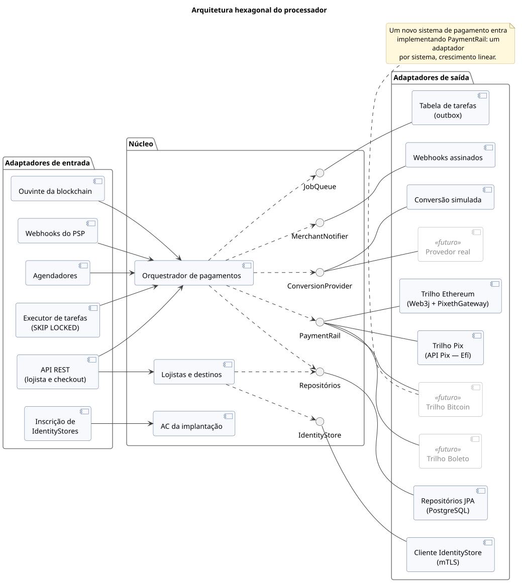
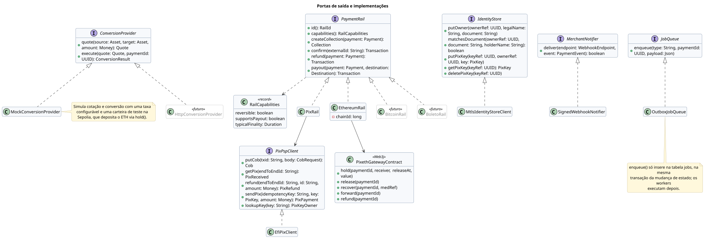

# 2. Arquitetura

## Decisões principais

- **Arquitetura hexagonal.** O núcleo só conhece portas: trilhos de pagamento (`PaymentRail`), conversão (`ConversionProvider`), IdentityStore, notificação e persistência. Cada integração é um adaptador substituível.
- **Crescimento linear.** Um novo sistema de pagamento (Bitcoin, boleto, cartões) entra com um novo adaptador de `PaymentRail`, sem adaptadores por par de sistemas.
- **Criação síncrona, o resto assíncrono.** Criar o pagamento é uma chamada síncrona e idempotente (o `PUT /cob/{txid}` do PSP pode ser repetido com segurança). O que acontece depois do pagamento roda em tarefas gravadas no PostgreSQL na mesma transação da mudança de estado e executadas por qualquer réplica (`FOR UPDATE SKIP LOCKED`). Não há *broker* de mensagens.
- **Conversão terceirizada.** A conversão BRL ⇄ ETH fica atrás de `ConversionProvider`; no TCC, uma implementação simulada.
- **Retenção fixa para MED.** No sentido Pix → Ethereum, o ETH fica retido no contrato por uma janela configurável antes de ser liberado ao lojista, para que um MED ainda possa ser atendido.

## Portas e adaptadores

[Fonte](diagrams/src/arquitetura/componentes-hexagonal.puml)

[Fonte](diagrams/src/arquitetura/portas-e-adaptadores.puml)
