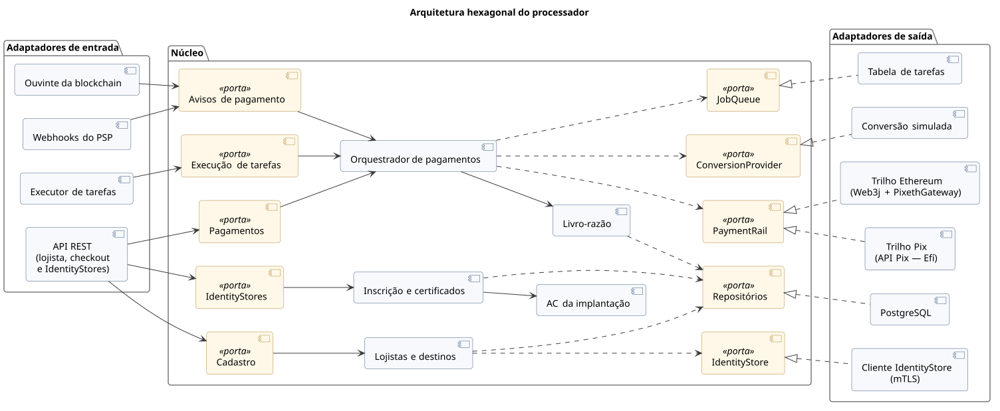
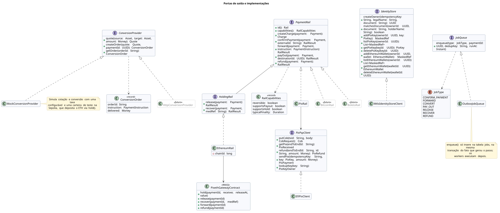

# 2. Arquitetura

## Decisões principais

- **Arquitetura hexagonal.** O núcleo só conhece portas, definidas nos termos dele. As portas de entrada (pagamentos, cadastro, avisos de pagamento, execução de tarefas e operação) recebem chamadas da API, do console do operador, dos *webhooks* do PSP, do ouvinte da *blockchain* e do executor de tarefas. As portas de saída (`PaymentRail`, `ConversionProvider`, `IdentityStore`, `JobQueue` e repositórios) são implementadas por adaptadores substituíveis. O que depende de tempo (liberar uma retenção, repetir uma tarefa) passa pelo executor, via `run_at`; não há agendadores à parte.
- **Crescimento linear.** Um novo sistema de pagamento (Bitcoin, boleto, cartões) entra com um novo adaptador de `PaymentRail`, sem adaptadores por par de sistemas.
- **Criação síncrona, o resto assíncrono.** Criar o pagamento é uma chamada síncrona e idempotente (o `PUT /cob/{txid}` do PSP pode ser repetido com segurança). O que acontece depois do pagamento roda em tarefas gravadas no PostgreSQL na mesma transação do fato que as gerou e executadas por qualquer réplica (`FOR UPDATE SKIP LOCKED`). Não há *broker* de mensagens.
- **Conversão terceirizada e agnóstica.** A conversão BRL ⇄ ETH fica atrás de `ConversionProvider`; no TCC, uma implementação simulada. O Pixeth recebe o pagamento e encaminha ao provedor o valor de cada pagamento (Pix ou `fundConversion()`), sem saldo pré-pago e sem depender de recursos de um PSP ou provedor específico.
- **Retenção fixa para MED.** No sentido Pix → Ethereum, o ETH fica retido no contrato por uma janela configurável antes de ser liberado ao lojista, para que um MED ainda possa ser atendido.

## Portas e adaptadores

[Fonte](diagrams/src/arquitetura/componentes-hexagonal.puml)

[Fonte](diagrams/src/arquitetura/portas-e-adaptadores.puml)

Cada tipo de tarefa é um passo do pagamento, igual para qualquer trilho; o trilho vem do pagamento (`source_rail` ou `destination_rail`), e a tarefa chama o adaptador correspondente:

| Tarefa | Porta e operação | Trilho |
|---|---|---|
| `CONFIRM_PAYMENT` | `PaymentRail.confirmPayment` | origem |
| `FUND_CONVERSION` | `ConversionProvider.createOrder` + `PaymentRail.fundConversion` (paga a cobrança do provedor) | origem |
| `CONVERT` | `ConversionProvider.getOrder` (entrega do ativo convertido) | — |
| `PAY_OUT` | `PaymentRail.payOut` | destino |
| `RELEASE` | `HoldingRail.release` | destino, se retém |
| `RECOVER` | `HoldingRail.recover` | destino, se retém |
| `REFUND` | `PaymentRail.refund` | origem |
