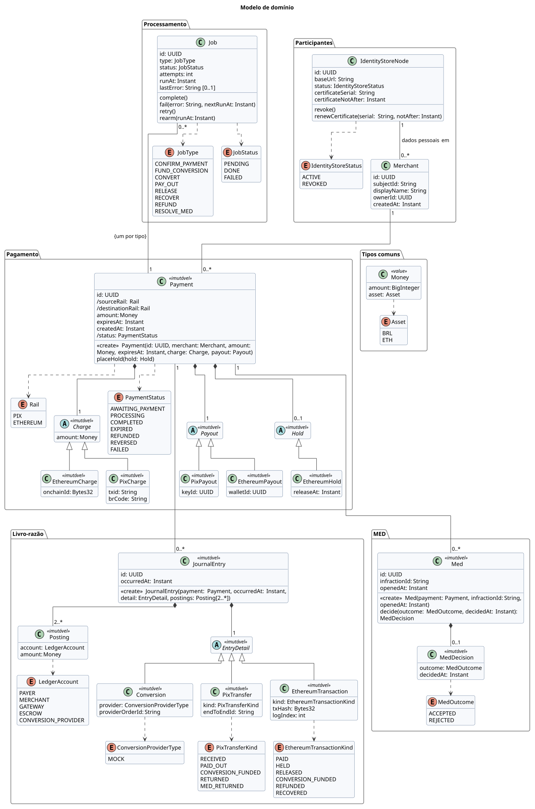

# 3. Modelo de domínio

`Payment` guarda o valor do pagamento com o seu ativo e a validade; esses dados não mudam depois de criado. Ele é dono de uma cobrança (`Charge`), de um destino (`Payout`) e, quando há retenção, de uma retenção (`Hold`): as partes são montadas antes e entregues ao pagamento, a cobrança e o destino na criação e a retenção com `placeHold`. Cada parte tem uma classe por trilho, e é essa classe que diz o trilho: `/sourceRail` e `/destinationRail` são derivados da cobrança e do destino (`PIX` ou `ETHEREUM`, em qualquer combinação). A cobrança guarda o valor que o pagador paga, no ativo do trilho de origem, que pode ser outro que o do pagamento. O estado (`/status`) é derivado do livro-razão, das tarefas e do prazo, e não é gravado.

Cada fato externo que move dinheiro vira um lançamento no livro-razão (`JournalEntry`), com partidas (`Posting`) que somam zero por ativo; as contas não dependem do trilho. O que aconteceu e o identificador externo ficam no único detalhe do lançamento (`EntryDetail`): `PixTransfer` (com o `endToEndId`), `EthereumTransaction` (com o `txHash`) ou `Conversion` (com o id do pedido no provedor de conversão).

Um MED (`Med`) pertence a um pagamento e recebe no máximo uma decisão do PSP (`MedDecision`, `ACCEPTED` ou `REJECTED`). Um pagamento pode ter mais de um MED; eles são tratados em conjunto.

Nome, CPF/CNPJ, chaves Pix e carteiras do lojista ficam no IdentityStore, que gera os próprios ids; o processador só registra esses ids (`ownerId`, e em cada pagamento o `keyId` ou `walletId` de destino, sempre informado explicitamente). Cada pagamento tem no máximo uma tarefa assíncrona (`Job`) de cada tipo, o que também faz a deduplicação; `rearm` reativa uma tarefa que já existe.

Classes marcadas como `«imutável»` (o pagamento e suas partes, os lançamentos com suas partidas e detalhes, e o MED com sua decisão) nunca mudam depois de criadas: uma correção é sempre um novo registro, nunca a alteração de um antigo.

[Fonte](diagrams/src/dominio/classes-dominio.puml)
