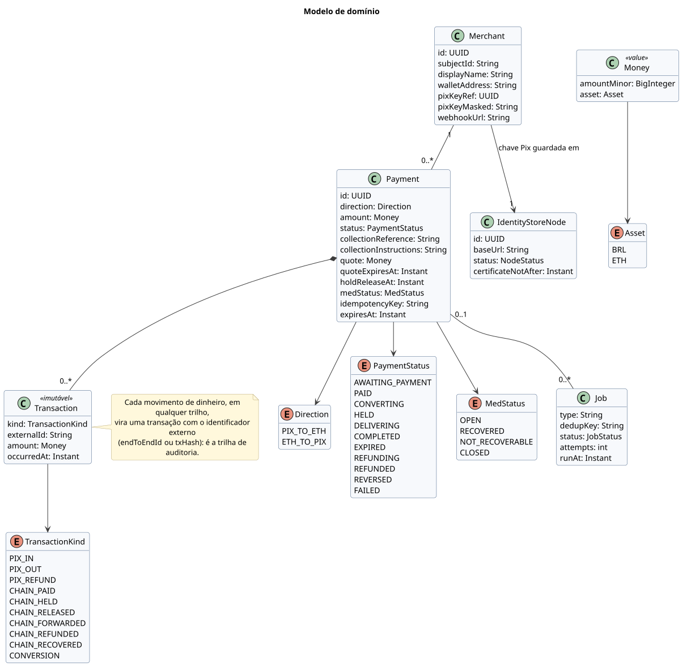

# 3. Modelo de domínio

`Payment` guarda a direção (`PIX_TO_ETH` ou `ETH_TO_PIX`), o valor em BRL e o estado. Cada movimento de dinheiro, em qualquer trilho, vira uma `Transaction` com o identificador externo (`endToEndId` ou `txHash`), o que forma a trilha de auditoria do pagamento. Cada lojista tem uma carteira e uma chave Pix. Nome, CPF/CNPJ, a chave e a carteira ficam no IdentityStore; o processador guarda só o `id` do lojista (usado como referência no IdentityStore) e, para a chave e a carteira, a referência e a versão mascarada. Tarefas assíncronas (`Job`) também fazem a deduplicação.

[Fonte](diagrams/src/dominio/classes-dominio.puml)
