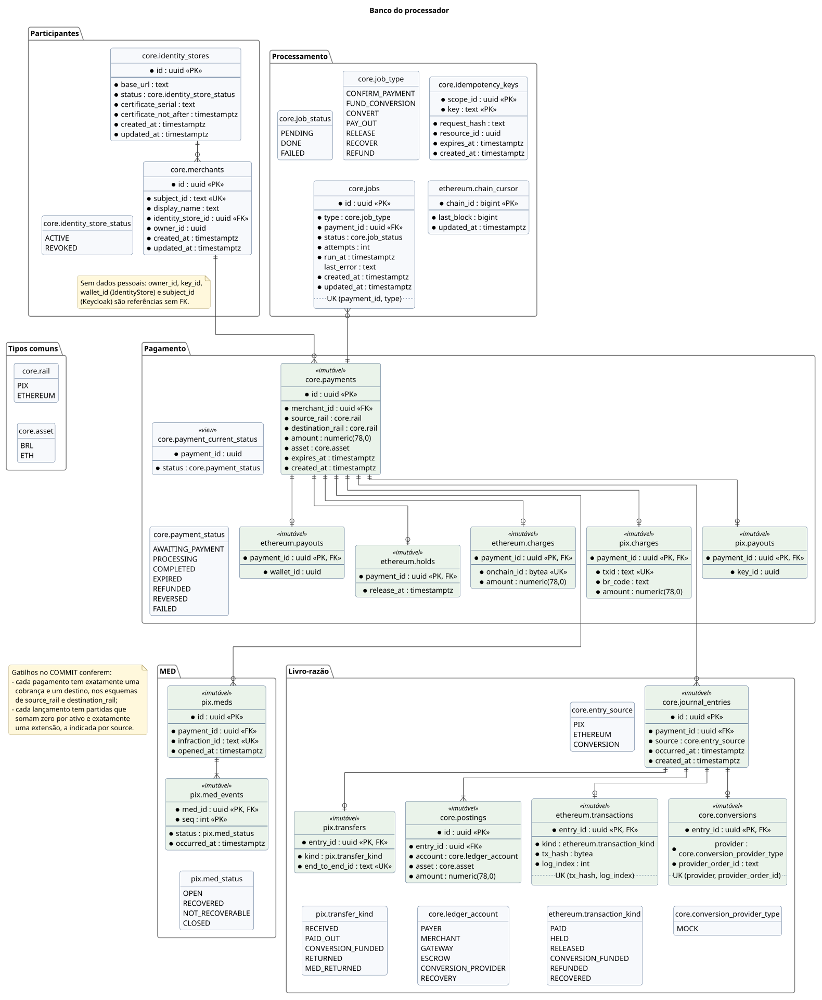
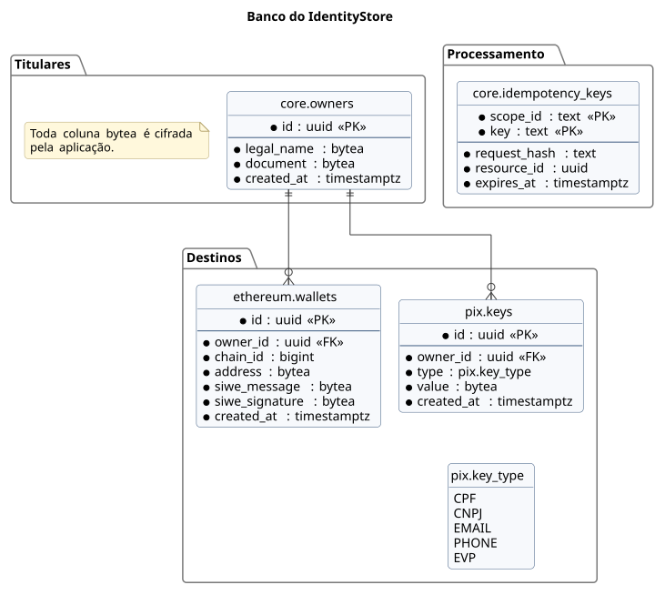

# 4. Banco de dados

O banco do processador não guarda dados pessoais: chaves Pix e carteiras ficam no IdentityStore, e o processador só registra os ids que ele gera. As tabelas ficam em *schemas*: `core` para o que vale para qualquer trilho e um *schema* por trilho de pagamento.

No diagrama, as tabelas aparecem agrupadas pelo papel que cumprem, e não pelo *schema*; o prefixo do nome (`core.`, `pix.`, `ethereum.`) continua mostrando a qual *schema* cada uma pertence.

**Tabelas imutáveis.** As tabelas marcadas como `«imutável»` (em verde no diagrama) nunca têm linhas alteradas nem apagadas: cada fato é gravado uma vez e permanece como registro. São o pagamento e suas extensões, o livro-razão com suas extensões e o MED. O banco garante isso por permissão: o papel da aplicação só recebe `SELECT` e `INSERT` nessas tabelas. As demais (`core.merchants`, `core.identity_stores`, `core.jobs`, `core.idempotency_keys` e `ethereum.chain_cursor`) guardam configuração ou estado operacional e podem ser atualizadas; nada do que aconteceu com um pagamento é sobrescrito.

**Participantes** — quem participa dos pagamentos.

| Tabela | Papel |
|---|---|
| `core.merchants` | Lojista: usuário no Keycloak, nome de exibição, IdentityStore e titular onde estão seus dados |
| `core.identity_stores` | IdentityStores inscritos e o certificado vigente de cada um |

**Pagamento** — o pagamento e suas extensões por trilho. Cada extensão tem uma linha por pagamento (chave primária = `payment_id`), gravada uma vez, com o que aquele trilho precisa para executar o pagamento.

| Tabela | Papel |
|---|---|
| `core.payments` | Dados comuns a todo pagamento, fixados na criação: trilhos de origem e de destino (qualquer combinação), valor, ativo e validade. `amount` é inteiro, na menor unidade do ativo (centavos para BRL, wei para ETH) |

O estado do pagamento não é gravado: a visão `core.payment_current_status` o deriva, com o tipo `core.payment_status` (que não aparece no diagrama, por não ser coluna de nenhuma tabela), do livro-razão, das tarefas e do prazo, na ordem abaixo (vale a primeira regra que se aplica). Como as contas das partidas não dependem do trilho, a regra vale para qualquer trilho, e o estado nunca diverge do que aconteceu com o dinheiro.

| Estado | Regra |
|---|---|
| `FAILED` | o pagamento tem uma tarefa em `FAILED` (cabe ao operador) |
| `REVERSED` | alguma partida credita `RECOVERY` (valor recuperado por MED) |
| `REFUNDED` | alguma partida credita `PAYER` (o dinheiro voltou ao pagador) |
| `COMPLETED` | alguma partida credita `MERCHANT` |
| `PROCESSING` | alguma partida debita `PAYER` (o pagador pagou) |
| `EXPIRED` | não há partidas e `expires_at` já passou |
| `AWAITING_PAYMENT` | não há partidas e `expires_at` ainda não passou |
| `pix.charges` | Cobrança Pix (pagador em Pix): `txid` e BR Code |
| `pix.payouts` | Envio Pix ao lojista: chave de destino escolhida na criação |
| `ethereum.charges` | Cobrança em ETH (pagador em ETH): `onchain_id` usado em `pay()` e valor cotado; a validade da cotação é o `expires_at` do pagamento |
| `ethereum.payouts` | Envio em ETH ao lojista: carteira de destino escolhida na criação |
| `ethereum.holds` | Retenção no contrato antes da liberação ao lojista |

**Livro-razão** — como o dinheiro se moveu, por partidas dobradas, e a prova de cada movimento. Cada lançamento tem exatamente uma extensão, indicada por `source` (`PIX`, `ETHEREUM` ou `CONVERSION`); a chave primária da extensão é o próprio `entry_id`, e o pagamento é alcançado pelo lançamento. A regra é um fato externo por lançamento: um Pix, um evento do contrato ou um pedido ao provedor de conversão. As contas das partidas dizem o sentido do dinheiro (por exemplo, `GATEWAY` → `PAYER` é uma devolução), e a extensão diz o que aconteceu no trilho.

| Tabela | Papel |
|---|---|
| `core.journal_entries` | Um lançamento por fato externo; `source` indica qual extensão o comprova |
| `core.postings` | Partidas de cada lançamento (conta, ativo, valor; positivo entra, negativo sai). Um gatilho `DEFERRABLE` confere no `COMMIT` que somam zero por ativo e que o lançamento tem exatamente uma extensão, a indicada por `source`. Neutralidade: ao fim de cada pagamento, `GATEWAY` e `ESCROW` somam zero |
| `pix.transfers` | Extensão do lançamento: o Pix recebido, enviado ao lojista, encaminhado ao provedor de conversão, devolvido ou devolvido por MED (`RECEIVED`, `SENT`, `FORWARDED`, `RETURNED`, `MED_RETURNED`), com o `endToEndId` (numa devolução, o id da devolução) |
| `ethereum.transactions` | Extensão do lançamento: o evento do contrato que o comprova (pagamento, retenção, liberação, encaminhamento, reembolso, recuperação), com `txHash` e `logIndex` |
| `core.conversions` | Extensão do lançamento: a entrega do provedor de conversão, isto é, o ativo convertido que ele devolve (`provider` e `provider_order_id`, o id que o provedor devolve). O valor enviado ao provedor é um lançamento à parte (`FORWARDED`, no trilho de origem). Uma tabela só para todos os provedores, porque a prova tem a mesma forma em todos |

**MED** — casos de devolução abertos pelo banco do pagador.

| Tabela | Papel |
|---|---|
| `pix.meds` | Um MED aberto para um pagamento |
| `pix.med_events` | Cada mudança de situação do MED; a situação atual é a linha de maior `seq` (mesma regra de concorrência do histórico de estados do pagamento) |

**Processamento** — o que move os pagamentos adiante.

| Tabela | Papel |
|---|---|
| `core.jobs` | Fila de tarefas: as réplicas buscam com `FOR UPDATE SKIP LOCKED`; `dedup_key` único descarta eventos repetidos (`pix:{endToEndId}`, `eth:{txHash}:{logIndex}`) |
| `core.idempotency_keys` | Idempotência de qualquer criação da API: `scope_id` é quem enviou a chave, `resource_id` o recurso criado e `request_hash` cobre método, caminho e corpo (a mesma chave com outro pedido dá 422). Apagada depois de `expires_at` (ex.: 24 h) |
| `ethereum.chain_cursor` | Último bloco lido da *blockchain* |

Ids entre serviços (o id do lojista no IdentityStore, o usuário no Keycloak) não são garantidos pelo banco: são referências lógicas que a aplicação mantém consistentes. Credenciais de API ficam no Keycloak; o desafio de assinatura da carteira (SIWE) não é guardado, porque volta assinado pelo próprio servidor.

## Processador

[Fonte](diagrams/src/banco-de-dados/er-processador.puml)

## IdentityStore

Guarda todos os dados pessoais do sistema, cifrados pela aplicação, e gera os próprios ids: o titular (`core.owners`: nome e CPF/CNPJ) e um *schema* por trilho de pagamento (`pix.keys`, `ethereum.wallets`), cada um com as tabelas e os campos do seu trilho.

[Fonte](diagrams/src/banco-de-dados/er-identitystore.puml)
