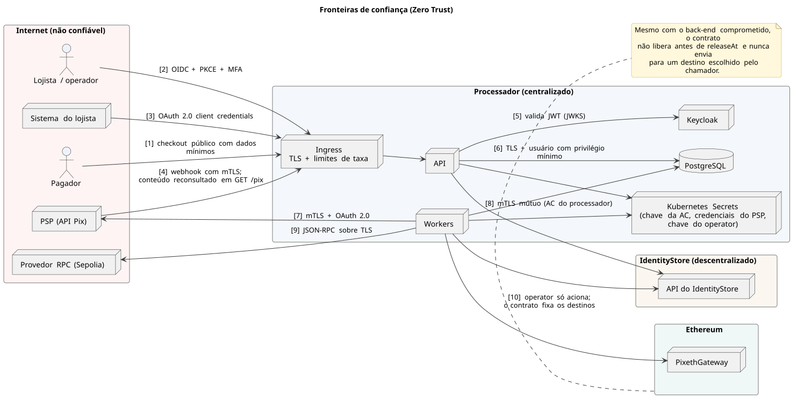

# 6. Segurança

## Fronteiras de confiança

Cada travessia numerada tem um controle explícito: OIDC com MFA, OAuth 2.0, mTLS, reconsulta de *webhooks*, privilégio mínimo ou regra do contrato. O processador mantém uma única autoridade certificadora; cada IdentityStore gera a própria chave e recebe o certificado ao se inscrever com um *token* de uso único (ver [IdentityStore](fluxos/identitystore.md)).

[Fonte](diagrams/src/seguranca/fronteiras-de-confianca.puml)
