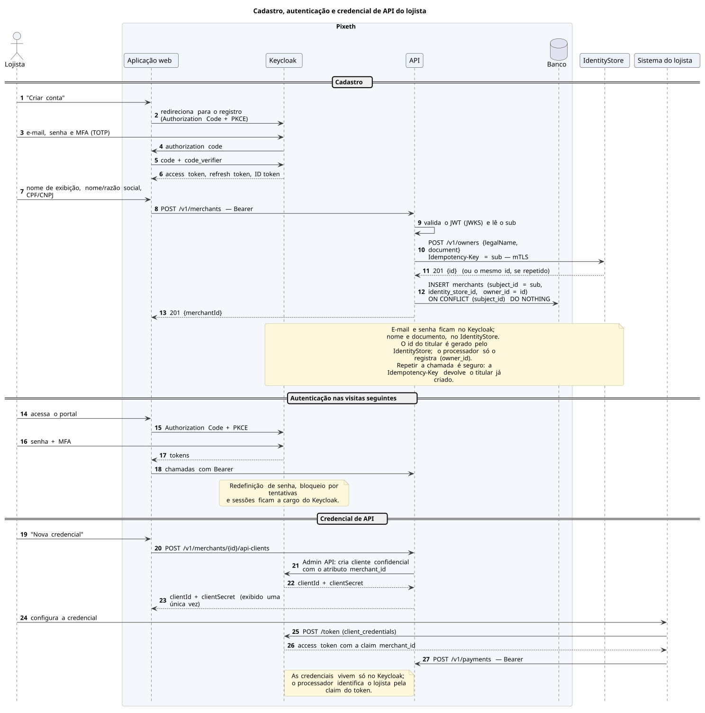
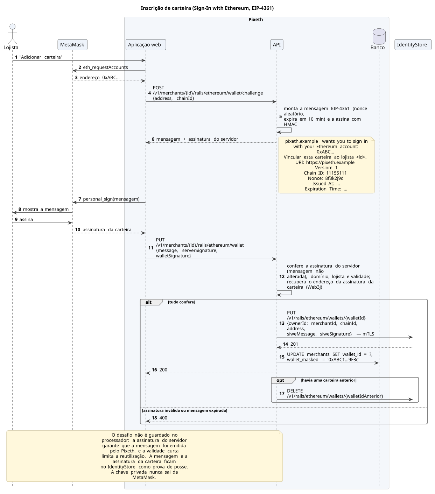
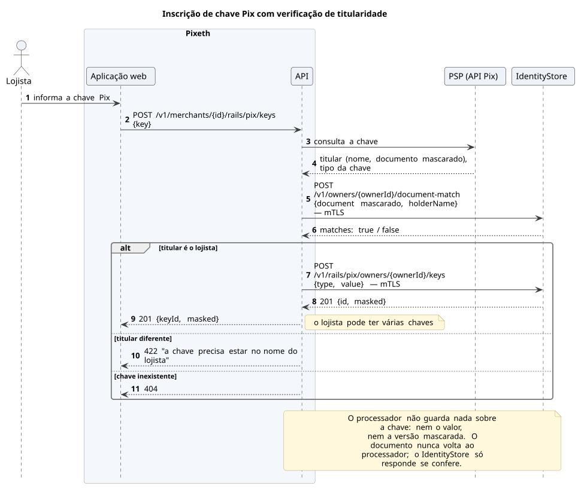

# Cadastro e destinos

Só lojistas e operadores têm conta. Autenticação, MFA, redefinição de senha e credenciais de API ficam a cargo do Keycloak. No cadastro, o nome e o CPF/CNPJ do lojista vão direto para o IdentityStore.

## Cadastro, autenticação e credencial de API

[Fonte](../diagrams/src/fluxos/seq-cadastro-e-login.puml)

## Carteira (Sign-In with Ethereum)

A assinatura da mensagem EIP-4361 prova que o lojista controla a carteira, sem transação e sem custo.

[Fonte](../diagrams/src/fluxos/seq-inscricao-carteira.puml)

## Chave Pix

A chave é consultada no PSP e só é aceita se estiver no nome do lojista: o IdentityStore compara o documento devolvido pelo PSP com o do cadastro, sem revelá-lo ao processador.

[Fonte](../diagrams/src/fluxos/seq-inscricao-chave-pix.puml)
