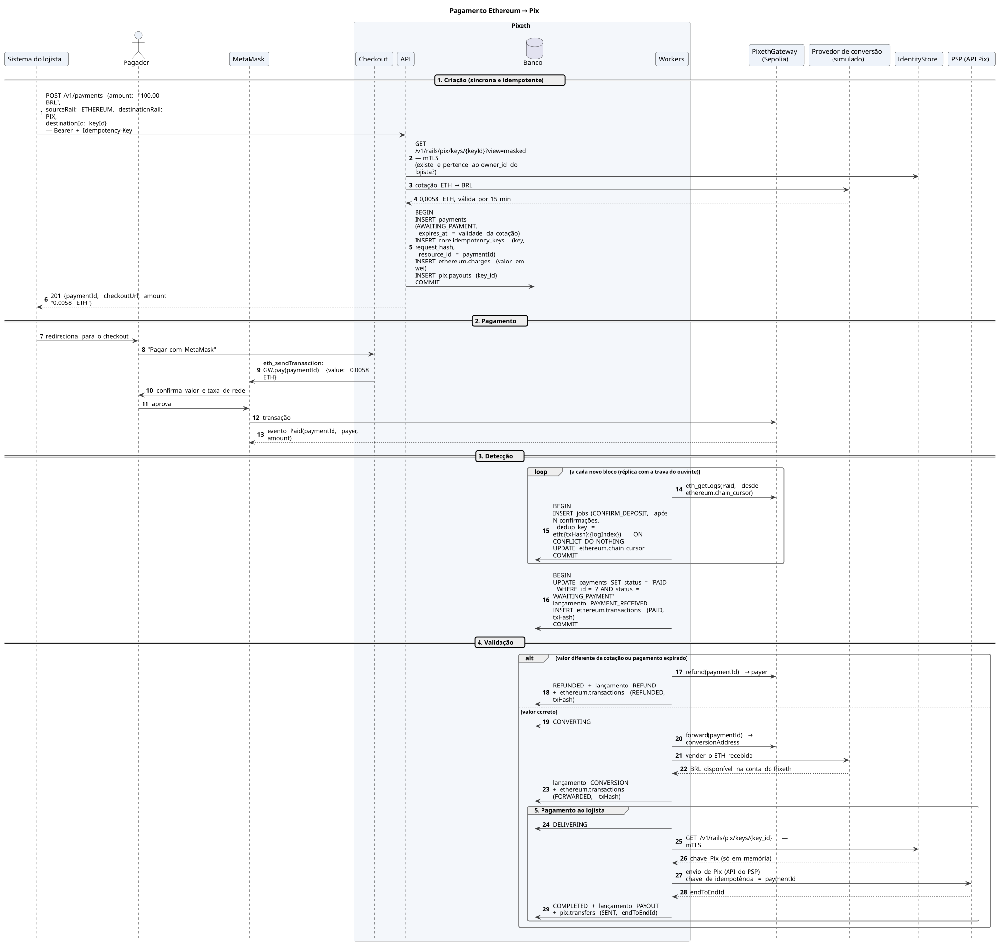
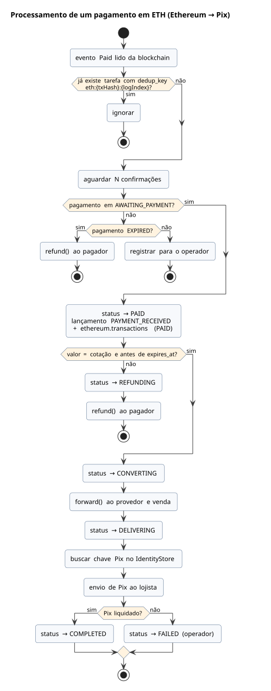

# Ethereum → Pix

O pagador usa a MetaMask para chamar `pay(paymentId)` com o valor cotado. A cotação vale 15 minutos: pagamento com valor diferente ou fora do prazo é devolvido automaticamente com `refund()` ao endereço que pagou. Como a entrada é irreversível, não há retenção.

## Sequência

[Fonte](../diagrams/src/fluxos/seq-ethereum-para-pix.puml)

## Processamento do pagamento em ETH

[Fonte](../diagrams/src/fluxos/atv-deposito-ethereum.puml)
