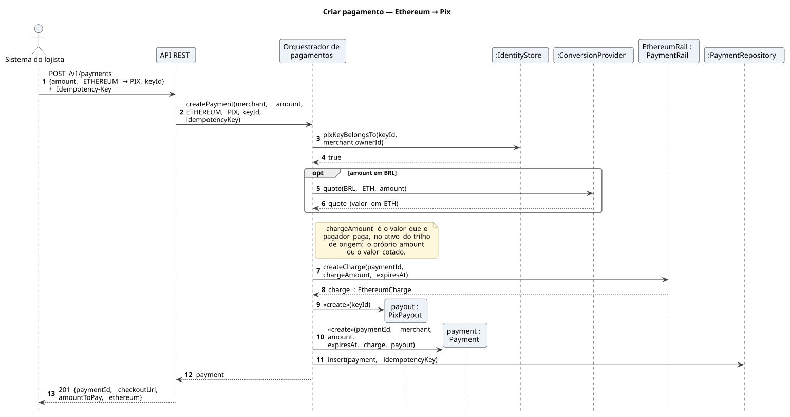
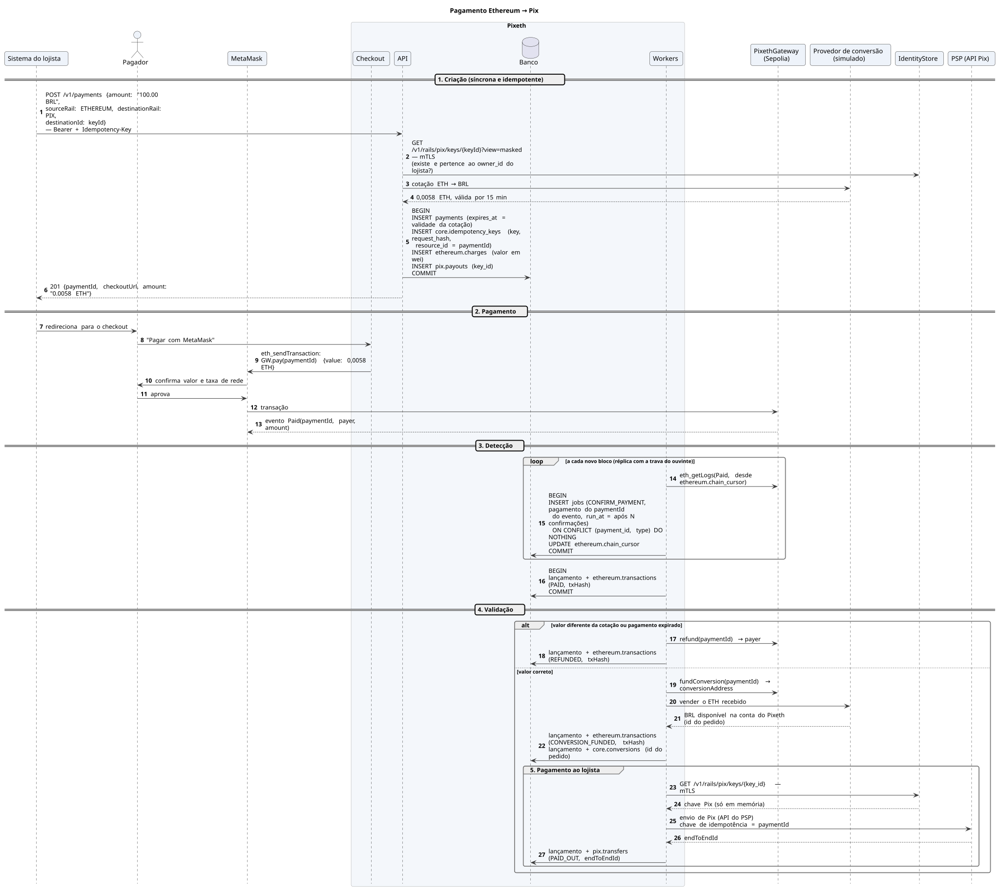
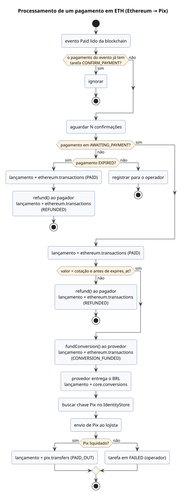

# Ethereum → Pix

O pagador usa a MetaMask para chamar `pay(paymentId)` com o valor a pagar. Pagamento com valor diferente ou fora do prazo é devolvido automaticamente com `refund()` ao endereço que pagou. Depois de confirmado, o Pixeth cria um pedido no provedor de conversão e envia a ele o ETH recebido com `fundConversion()`; o contrato só envia a endereços da lista de provedores. Com o BRL em conta, o Pixeth envia o Pix à chave do lojista. Como a entrada é irreversível, não há retenção.

## Criação

O valor do pagamento pode estar em BRL ou em ETH. O valor a pagar é sempre em ETH, o ativo do trilho de origem: quando o valor do pagamento está em BRL, ele é cotado na criação e vale 15 minutos, a validade do pagamento. Antes de criar a cobrança, o orquestrador confere no IdentityStore se a chave Pix de destino é do lojista.

[Fonte](../diagrams/src/fluxos/seq-criar-pagamento-eth-pix.puml)

## Sequência

[Fonte](../diagrams/src/fluxos/seq-ethereum-para-pix.puml)

## Processamento do pagamento em ETH

[Fonte](../diagrams/src/fluxos/atv-deposito-ethereum.puml)
