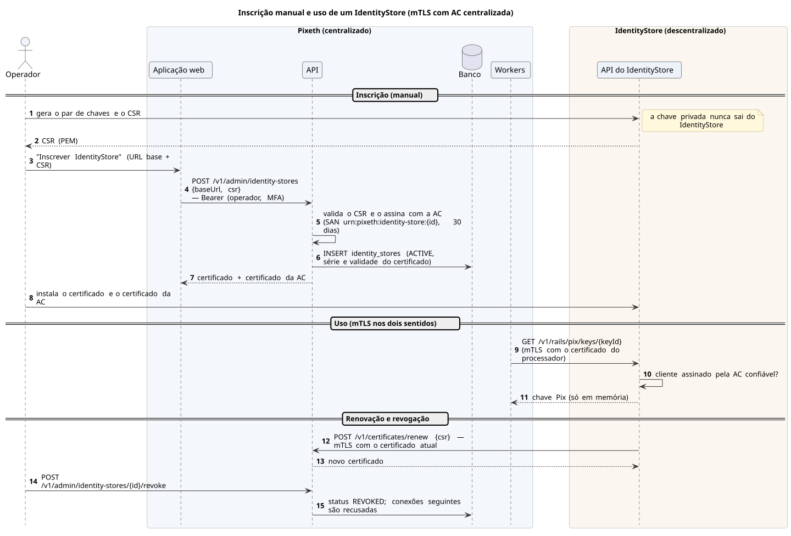

# IdentityStore

O IdentityStore gera a própria chave e o CSR; o operador envia o CSR no console e instala o certificado emitido pela AC do processador. A partir daí, toda comunicação entre os dois usa mTLS, e a renovação é feita com o próprio certificado.

[Fonte](../diagrams/src/fluxos/seq-inscricao-identitystore.puml)
