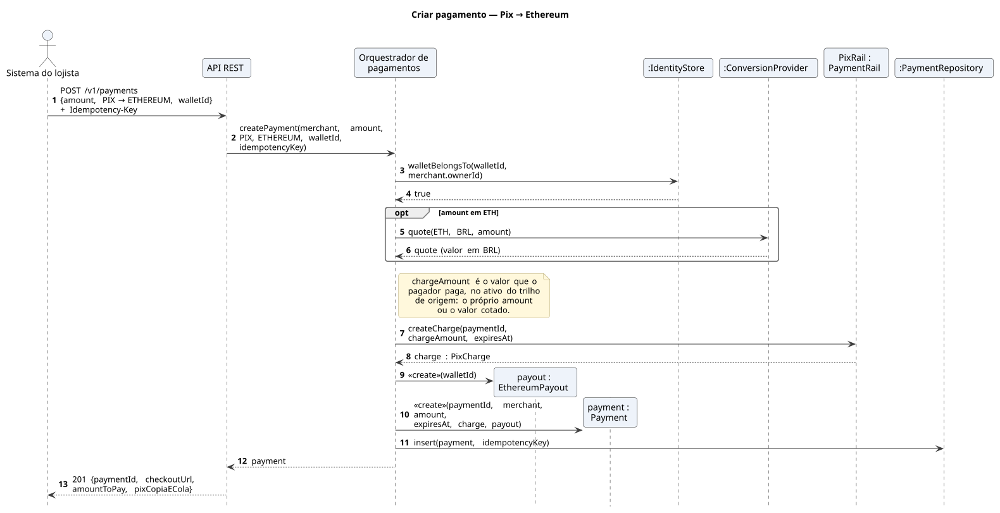
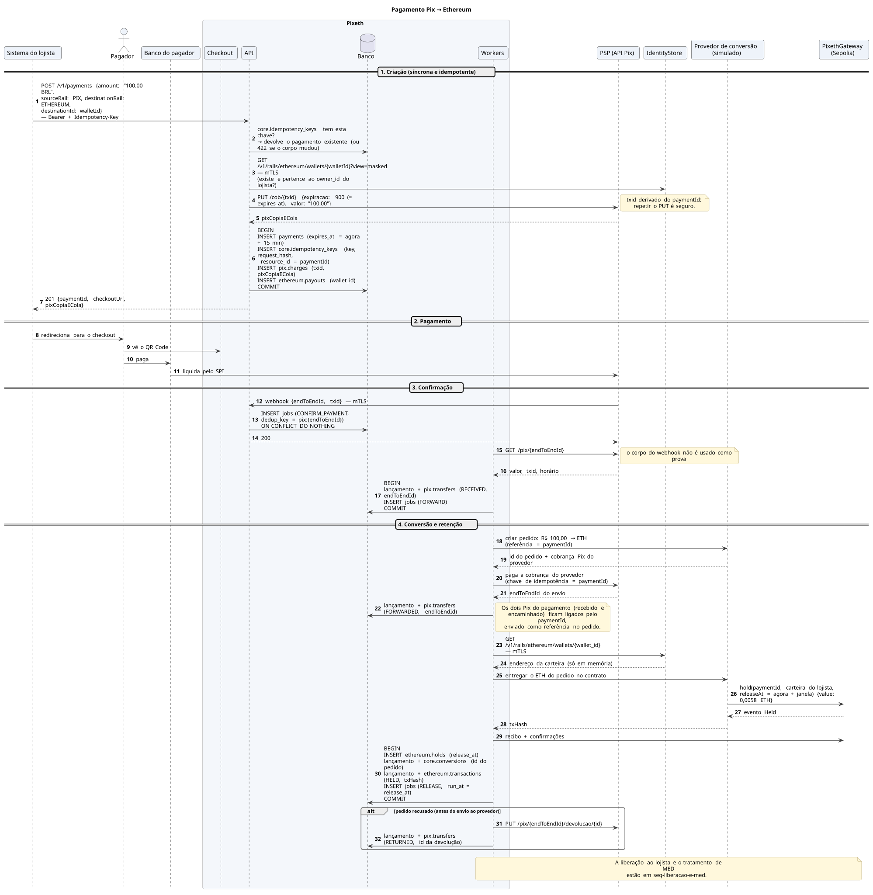
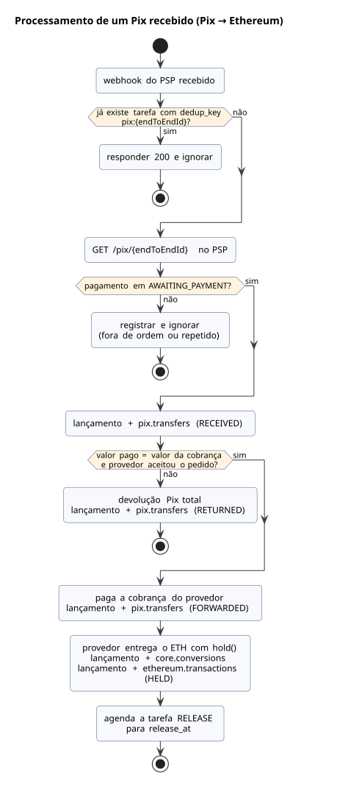

# Pix → Ethereum

O pagador paga um QR Code Pix ao Pixeth. O Pixeth cria um pedido no provedor de conversão, com o `paymentId` como referência, e paga a cobrança Pix do provedor (`CONVERSION_FUNDED`), como faz com `fundConversion()` no sentido Ethereum → Pix. O provedor deposita o ETH no contrato com `hold()`, e o valor fica retido por uma janela configurável antes de ser liberado à carteira do lojista (ver [Retenção e MED](retencao-e-med.md)).

O Pixeth não depende de recursos de um PSP ou provedor específico: cada pagamento leva seu próprio dinheiro ao provedor, sem saldo pré-pago compartilhado, e qualquer PSP ou provedor que ofereça cobrança e envio de Pix pode ser plugado.

## Criação

O valor do pagamento pode estar em BRL ou em ETH. O valor a pagar é sempre em BRL, o ativo do trilho de origem: quando o valor do pagamento está em ETH, ele é cotado na criação e vale até o pagamento expirar. Antes de criar a cobrança, o orquestrador confere no IdentityStore se a carteira de destino é do lojista.

[Fonte](../diagrams/src/fluxos/seq-criar-pagamento-pix-eth.puml)

## Sequência

[Fonte](../diagrams/src/fluxos/seq-pix-para-ethereum.puml)

## Processamento do Pix recebido

[Fonte](../diagrams/src/fluxos/atv-pix-recebido.puml)
