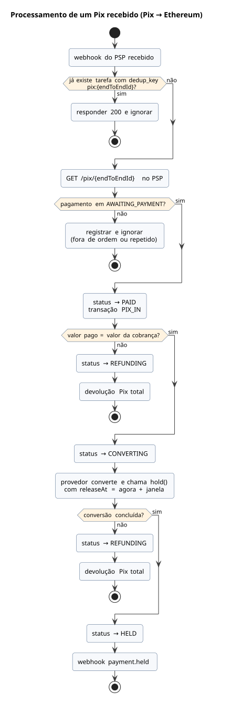

# Pix → Ethereum

O pagador paga um QR Code Pix; o provedor de conversão deposita o ETH no contrato com `hold()`, e o valor fica retido por uma janela configurável antes de ser liberado à carteira do lojista (ver [Retenção e MED](retencao-e-med.md)).

## Sequência

[Fonte](../diagrams/src/fluxos/seq-pix-para-ethereum.puml)

## Processamento do Pix recebido

[Fonte](../diagrams/src/fluxos/atv-pix-recebido.puml)
