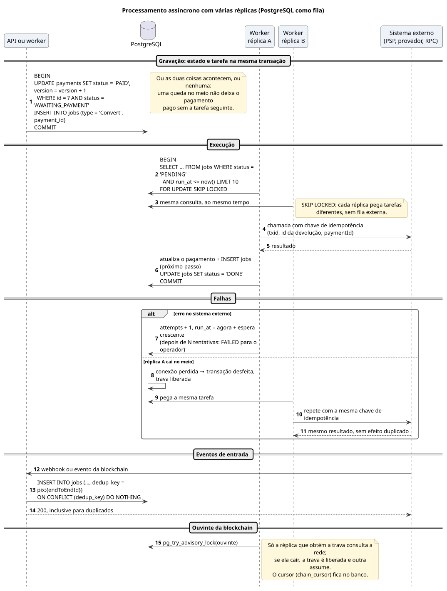

# Processamento assíncrono

O PostgreSQL faz o papel de fila: a mudança de estado e a próxima tarefa são gravadas na mesma transação, e qualquer réplica pode executar qualquer tarefa. A deduplicação usa restrições únicas, sem travas distribuídas:

| Onde | Chave | Mecanismo |
|---|---|---|
| API | `Idempotency-Key` | chave única `(merchant_id, idempotency_key)` em `payments`; repetição devolve o pagamento existente |
| *Webhooks* do PSP | `endToEndId` | tarefa com `dedup_key = pix:{endToEndId}` |
| Eventos da *blockchain* | `txHash:logIndex` | tarefa com `dedup_key = eth:{txHash}:{logIndex}` |
| Transições de estado | estado atual | `UPDATE … WHERE id = ? AND status = ?` |
| Chamadas externas | chave do sistema externo | `txid`, id da devolução, `paymentId` |

[Fonte](../diagrams/src/fluxos/seq-processamento-assincrono.puml)
