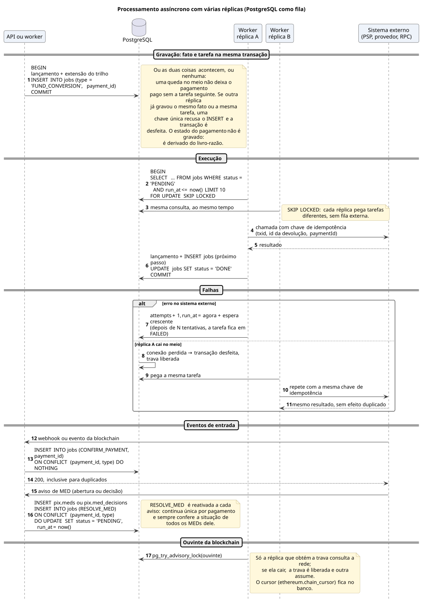

# Processamento assíncrono

O PostgreSQL faz o papel de fila: o fato (lançamento e extensão do trilho) e a próxima tarefa são gravados na mesma transação, e qualquer réplica pode executar qualquer tarefa. A deduplicação usa restrições únicas, sem travas distribuídas:

| Onde | Chave | Mecanismo |
|---|---|---|
| API | `Idempotency-Key` | chave primária `(scope_id, key)` em `core.idempotency_keys`; repetição devolve o recurso criado |
| Passos do pagamento | pagamento + tipo | `UNIQUE (payment_id, type)` em `core.jobs`: cada passo existe uma vez por pagamento. *Webhooks* repetidos do PSP (pelo `txid`) e eventos relidos da *blockchain* (pelo `paymentId`) caem no mesmo `CONFIRM_PAYMENT` e são descartados com `ON CONFLICT DO NOTHING` |
| Fatos no trilho | id do trilho | `end_to_end_id`, `(tx_hash, log_index)` e `(provider, provider_order_id)` únicos nas extensões |
| Chamadas externas | chave do sistema externo | `txid`, id da devolução, `paymentId` |

[Fonte](../diagrams/src/fluxos/seq-processamento-assincrono.puml)
