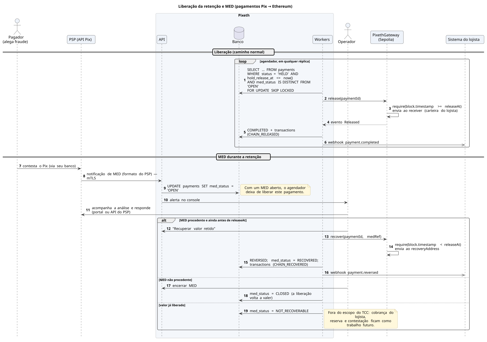

# Retenção e MED

O Pix pode ser revertido por MED; a entrega na *blockchain* não. Por isso, no sentido Pix → Ethereum, o ETH fica retido no contrato até `releaseAt`. Enquanto houver um MED aberto, a liberação é suspensa; se o MED for procedente, o operador chama `recover()`. O MED não faz parte da especificação padrão da API Pix: cada PSP o expõe do seu jeito, e no TCC a análise e a resposta ao PSP são feitas manualmente pelo operador.

[Fonte](../diagrams/src/fluxos/seq-liberacao-e-med.puml)
