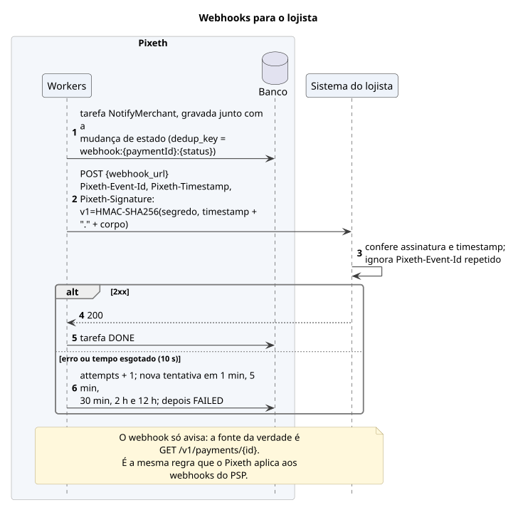

# *Webhooks*

Cada entrega é assinada com HMAC-SHA256 e repetida algumas vezes em caso de falha. O *webhook* só avisa; a fonte da verdade é `GET /v1/payments/{id}`.

[Fonte](../diagrams/src/fluxos/seq-webhooks-lojista.puml)
